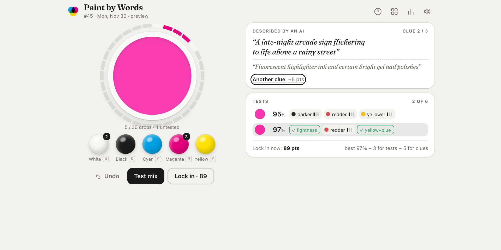

# Restoration



**One painting a day. One part of it has lost its color. Put it back.**

A daily data game for NYU Game Design (Fall 2026), Week 6. Each day is a public-domain painting from the [Art Institute of Chicago](https://www.artic.edu/open-access/open-access-images). One region, such as a dress, a boat or a field, has had its color taken out, while its brushwork and shading are still there. You pick a color on a hue ring and the patch repaints live, so you judge it against the rest of the painting. Then you test how close you are.

## Play

<https://stevenli-phoenix-work.itch.io/week6-data-game>

1. **Find the gray patch.** It is outlined until you pick a color.
2. **Pick a color.** Drag the ring for hue and the square for saturation (left–right) and brightness (up–down). Arrow keys nudge the focused handle; hold Shift for bigger steps. The patch takes on your color as you drag.
3. **Test.** You get a match % and three arrows: lighter/darker, redder/greener, yellower/bluer. Move the picker and test again. A color you already tested can't be tested twice.
4. **Lock in.** Score = best match − 3 for each test after the first. Six tests at most.

At the end you can flip between your version and the original, see where you placed among everyone who played that painting, and open the leaderboard (today and all time). You also see both colors in RGB, how far off each channel was, and what the xkcd Color Survey crowd would call the color. Past days are in the archive. Stats, streak and a Wordle-style share grid are kept in the browser.

## How it meets the brief

| Criterion (Lecture 6) | How |
|---|---|
| **Objective**, one right answer and a score | The answer is the region's mean color in OKLab, computed from the museum's image. Match % is a fixed function of OKLab distance (Gaussian, σ = 0.15: 0.05 → 89%, 0.10 → 64%), so two players with the same pick get the same number. A perfect pick restores the original pixels exactly. |
| **Reasonable** for an average player | The painting around the patch is the hint: the same color often appears elsewhere, and the light, the palette and the subject all point somewhere. The picker reaches every sRGB color, and nothing carries over between tests, so one bad guess never locks you out. |
| **Competitive** | One number per day, shareable as `🟧🟨🟩 3 tests · 89 pts`. Fewer tests score higher. After each round you see where you placed ("you beat 75% of 40 players · #6 today") and everyone's best color side by side. A leaderboard ranks today's round and all-time totals; the server re-scores every round from the colors tested, so a score can't be typed in. |
| **Learnable** | The feedback axes are the opponent-color axes your eyes use, so players learn how the hints map onto the wheel. Seeing the original after each round teaches how painters actually used color, e.g. how much darker a sunlit dress really is than it looks. |
| **Replayable** | A new painting every day; every past day stays playable in the archive. |
| **Skill expression** | Easy: drag, press Test. Hard: reading color in context (a patch looks different next to its neighbours), turning three arrows into the right move on the wheel, and knowing when another test (−3) is worth it. |
| **External data** | The paintings and their metadata come from the Art Institute of Chicago's public API (artwork data CC0, public-domain images). Color names come from the xkcd Color Survey (CC0), in `data/xkcd-rgb.txt`. |
| **At least 7 days of levels** | `web/levels.js` holds 80 days, 2026-10-17 to 2027-01-04. CI fails if it drops below 7. |
| **Novel** | Daily color games (Hexcodle, Colordle, Hued, Colorfle) match a color through numeric feedback against a bare swatch. Here the target only exists in context, inside a real painting, and you see your guess in place. |
| **Bonus: automated levels** | `scripts/build_paintings.py` generates every level end to end (below). |

## How levels are made

```
Art Institute of Chicago API: public-domain paintings the museum highlights
  → download at 843 px, scale to 560 px on the long side; skip scrolls and panoramas
  → SLIC superpixels, merged when their OKLab colors are close
    (lightness counts for a third: the game keeps shading, so a lit-and-shadowed dress stays one region;
     tried at three merge strengths)
  → score every region: subject-sized (2.5–22% of the painting), stands out from what surrounds it,
    fairly even inside, not hugging the frame (that is usually sky or background)
  → answer = the best region's mean OKLab color
  → <id>.jpg: region stored as neutral gray + each pixel's OKLab offset from the answer
    <id>-full.jpg: the original, shown at the end
  → seeded daily order, never the same artist within three days → web/levels.js
```

The game repaints the region as `pick + offset`, so the shading and brushwork survive in any color you try. The builder also writes a contact sheet of every chosen region to `data/aic-cache/review.jpg`, so you can drop bad picks with `--skip <id,id>`. API replies and images are cached there too (git-ignored), so re-runs are offline.

```bash
pip install -r scripts/requirements.txt
# the shipped levels; --skip drops 11 paintings whose region looked wrong on the contact sheet
python3 scripts/build_paintings.py --days 90 --pages 2 --skip 88793,185651,16551,57051,16362,110663,49195,869,64724,28849,14591
```

Of the museum's 117 highlighted public-domain paintings, 80 make it into the game. The rest are panoramas, have no region that passes the scoring, or were dropped on review.

## Layout

```
web/                     the game, shipped to itch.io as-is (plain ES modules, no build step)
  color.js               sRGB ↔ OKLab, HSV for the picker, match %, per-axis hint
  painting.js            decodes the hidden region and repaints it in the picked color
  state.js               game rules as pure functions (pick, tests, points)
  scores.js              client for the score server; every call fails soft
  game.js                DOM, canvas, color picker, sound, storage, dialogs
  levels.js              generated: one painting per day, its region and answer
  paintings/             generated: <id>.jpg (region removed) and <id>-full.jpg (original)
worker/                  score server: Cloudflare Worker + D1 (below)
  index.js               routes; scores.js re-scores rounds with the game's own rules; schema.sql
scripts/
  build_paintings.py     level generator (above)
  check-html5.mjs        itch.io HTML5 bundle validator
data/xkcd-rgb.txt        the color survey (CC0), for naming the answer
tests/                   color math, rules, repainting, level file, score server checks
```

## Run locally

```bash
python3 -m http.server -d web 8000   # → http://localhost:8000/   (#day=12 opens a given day)
node --test tests/*.test.mjs scripts/*.test.mjs
node scripts/check-html5.mjs web
```

The page has to be served over http(s): the canvas can't read the painting's pixels from a `file://` page.

## Score server

Everyone's results and the leaderboard come from a small Cloudflare Worker in `worker/` with one D1 (SQLite) table. Players are an anonymous random id kept in the browser plus an optional name; there are no accounts. The game calls `https://restoration.lishuyustevenli.workers.dev` (`web/scores.js`, or `http://127.0.0.1:8787` when the page is served from localhost). If the server can't be reached, the game plays as before without the social parts.

| | |
|---|---|
| `POST /api/results` | `{ day, device, name, tests: ['#RRGGBB', …] }`. The server scores the round from the tested colors and keeps the first round per player per day; sending it again only updates the name. Returns the day's results. |
| `POST /api/name` | `{ device, name }`: renames the player on every day. |
| `GET /api/day/:n?device=…` | Count, top 10, everyone's best colors (up to 300, closest first), a score histogram, and the asking player's rank. |
| `GET /api/leaderboard?device=…` | All-time totals, top 20, and the asking player's rank. |

The server is live (deployed 2026-10-19). Its D1 database `restoration` already exists and `wrangler.jsonc` holds its id, so a redeploy is just `npx wrangler deploy` from the `worker/` folder, logged in to the Cloudflare account (`npx wrangler login`).

Setting it up from scratch (a new account or a fresh database):

```bash
npx wrangler d1 create restoration                     # copy the database_id it prints into wrangler.jsonc
npx wrangler d1 execute restoration --remote --file schema.sql
npx wrangler deploy
curl https://restoration.lishuyustevenli.workers.dev/api/health   # {"ok":true}
```

After that, `npx wrangler deploy` again whenever `worker/`, `web/levels.js` or the scoring rules change (the Worker bundles them). To run it locally: `npx wrangler d1 execute restoration --local --file schema.sql && npx wrangler dev`, then serve `web/` on localhost.

## Publishing

Every push to `main` runs the tests and publishes `web/` to `stevenli-phoenix-work/week6-data-game:html5` with [butler](https://itch.io/docs/butler/). The build's user version is the commit SHA, so `butler status` shows exactly which commit is live. Pull requests only run the checks and never see the `BUTLER_API_KEY` secret, which comes from the `game-design-projects` org (org secrets reach public repos only on GitHub's free plan, so this repo stays public).

## Credits

Paintings: Art Institute of Chicago, public domain, via its [open-access API](https://api.artic.edu/docs/); each level links to the artwork's page. Color names: xkcd Color Survey by Randall Munroe (CC0). Fraunces typeface by Undercase Type (OFL).

Earlier versions of this week's game are on archive branches: [`archive/paint-by-words`](../../tree/archive/paint-by-words) (AI-written clues, paint mixing, then a color picker) and [`archive/daily-data`](../../tree/archive/daily-data) (the first prototype).
